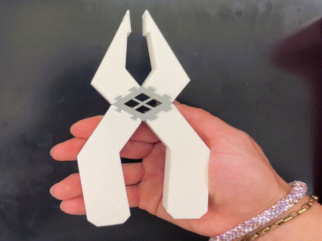

## Print-in-Place Designs

The $w_p$ (width of the pinch section) should be as small as possible. In the ideal case, it should be as large as the largest particle diameter, 150 um. Because I do not want particles to get stuck, the width of the pinch section was chosen to be 0.25 mm.

## Height of the channel
To have PFF, laminar flow is required. Thus, the width of the pinch and broad sections must be much greater than the height of that section. Thus, the width of the pinch and broad section should be 2x and at least 10x the height of the pinch and broad section, respectively. Because the broad section width is set at 19 mm, we must ensure the height is at most 1.9 mm $(10 \times 1.9 \text{ mm} = 19 \text{ mm} = w_b)$. 

## Length of the $w_p \text{and} w_b$ sections

## Determining the location of the enhanced pinch flow fractionation section
The enhanced section must start in a location such that it collects the particle farthest from the upper wall. Thus, we calculate particle positions from the bottom wall of the broad section using the $Y_{PFF}$ equation.

Where $Y_{PFF}$ is the location of the radius of the particle from the lower wall. Thus, we use the 150 um particle diameter. With a $w_p = 0.25$ mm, the location of the center 150 um particle is 13.3 mm from the bottom wall. Therefore, the farthest part of the 150 um from the upper wall is $13.3 \text{ mm} - 0.075 \text{ mm} = 13.225 \text{ mm}$. To collect the largest diameter particle, the distance of the edge of the enhanced pinched section from the upper wall should be $19 \text{ mm} - 13.225 \text{ mm} = 5.775 \text {mm}$. To account for any irregularities in flow, an additional 0.5 mm will be added to this value (for a total of 6.275 mm from the upper wall) to ensure collection of particles. 

| Specification | Size (mm) |
| ----------- | ----------- |
| Jaw Length | 63 |
| Jaw Resting Capacity| 14.5|
| Jaw Max Capacity | 17|
| Flexible Component | 20 x 20 |
| Handle Length | 70 |
| Plier Height | 15 |

# CAD Model

<iframe src="https://vanderbilt643.autodesk360.com/shares/public/SH90d2dQT28d5b602811173105476a813c84?mode=embed" width="640" height="480" allowfullscreen="true" webkitallowfullscreen="true" mozallowfullscreen="true"  frameborder="0"></iframe>

 



